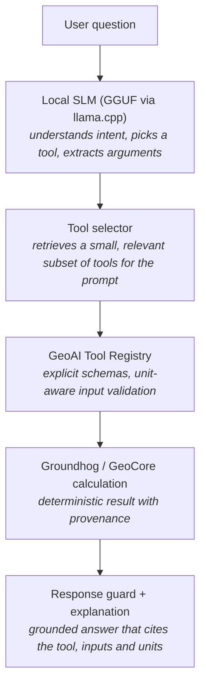
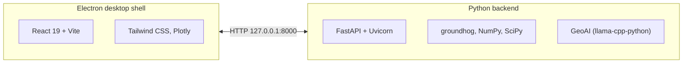

<p align="center">
  <picture>
    <source media="(prefers-color-scheme: dark)" srcset="electron-app/public/logo.png">
    
  </picture>
</p>

<p align="center">
  <strong>Offline geotechnical calculations you can check.</strong><br>
  An open-source desktop workstation built on <a href="https://github.com/snakesonabrain/groundhog">groundhog</a>, with GeoAI, a local assistant that never does the arithmetic itself.
</p>

<p align="center">
  <a href="LICENSE"></a>
  <a href="https://github.com/utkarsh-1912/geocore/releases/latest"></a>
  <a href="https://github.com/utkarsh-1912/geocore/actions/workflows/ci.yml"></a>
  <a href="https://github.com/utkarsh-1912/geocore/actions/workflows/release.yml"></a>
  
  
</p>

<p align="center">
  <a href="https://github.com/utkarsh-1912/geocore/releases/latest">Download</a> ·
  <a href="website/_content/geocore/changelog.md">Changelog</a> ·
  <a href="CONTRIBUTING.md">Contributing</a> ·
  <a href="SECURITY.md">Security</a> ·
  <a href="CODE_OF_CONDUCT.md">Code of conduct</a>
</p>

---

## Contents

- [Why GeoCore](#why-geocore)
- [Download](#download)
- [Features](#features)
- [GeoAI](#geoai)
- [Architecture](#architecture)
- [Development](#development)
- [Building installers](#building-installers)
- [Contributing](#contributing)
- [Citing GeoCore](#citing-geocore)
- [License and credits](#license-and-credits)
- [Disclaimer](#disclaimer)

## Why GeoCore

- **Offline.** Your project data, calculations and the GeoAI model stay on your computer. Nothing is uploaded.
- **Deterministic.** Every number comes from groundhog or GeoCore's own clause-cited code: the same inputs give the same answer, with units shown.
- **Checkable.** Each calculator has a Guide & Theory page with the method, equations, parameters and references, and every result can be traced to its inputs.
- **Open source.** GPLv3. Read the method behind any result, or change it.

## Download

Installers are published on the [Releases page](https://github.com/utkarsh-1912/geocore/releases/latest).

| Platform | Package | Architecture |
| :--- | :--- | :--- |
| Windows | Setup `.exe` (per-user installer, auto-updates) | x64 |
| macOS | `.dmg` and `.zip` (auto-update needs a code-signed build) | Apple Silicon (arm64) and Intel (x64) |
| Linux | `.AppImage` (auto-updates) and `.deb` | x64 |

What changed in each release is in the [changelog](website/_content/geocore/changelog.md).

## Features

221 calculators in 10 engineering areas, organised by task (with a classic groundhog-library view), each with a validated form, units, plots and export.

**Site investigation and ground characterisation**
- PCPT processing and correlations (Ic, Qtn, Fr, su, φ′, Dr, Gmax, Vs, …)
- SPT corrections and correlations (N60, (N1)60, relative density, …)
- Soil classification, phase relations and a phase-relations solver
- AGS 3.1 / 4 import and conversion

**Foundations and settlement**
- CPT-based axial pile capacity: LCPC (Bustamante & Gianeselli), Koppejan, De Beer
- Axial capacity profiles, negative skin friction (Zeevaert–De Beer), pile load–settlement curves and load-test extrapolation
- Shallow foundation bearing capacity (Eurocode 7, Vesic, API RP 2GEO), elastic and Schmertmann settlement
- Stress distribution (Boussinesq, Westergaard, strip and circular loads)

**Soil dynamics and liquefaction**
- CPT-based liquefaction triggering (Boulanger & Idriss, Robertson & Wride, Robertson & Cabal)
- Cyclic accumulation (Andersen contour diagrams), Gmax and modulus-reduction curves

**Standards**
- Eurocode 7: partial factors for DA1-1, DA1-2, DA2 and DA3, and characteristic value selection
- Indian Standards (BIS), implemented in GeoCore with clause references:
  - IS 6403 bearing capacity;
  - IS 1904 settlement limits and stability;
  - IS 2950 raft rigidity;
  - IS 1892 investigation depth and borehole layout;
  - IS 2131 SPT corrections;
  - IS 1498 soil classification;
  - IS 2720 laboratory tests.

**Project workflow**
- Compare the methods of a calculation side by side, with a suggested method for the data you have
- A project ground model: values from soil profiles, CPT and AGS data are offered as inputs, with their source
- Saved runs that flag when their inputs change, HTML/PDF reports and reviewer sign-off
- Interactive Plotly charts, CSV and JSON export, calculation history and a command palette

## GeoAI

GeoAI is fully local. There is no cloud LLM and no separate model server: the model is loaded in-process through `llama-cpp-python` from a GGUF file on disk.



Design rules (the full list is in [AGENTS.md](AGENTS.md)):

- **The model reasons; groundhog calculates.** The model never does the engineering arithmetic itself.
- **Whitelisted tools only.** The model cannot run arbitrary Python, shell, SQL or file operations.
- **No invented inputs.** Missing or invalid parameters come back as tool errors, and GeoAI asks the user.
- **Grounded explanations.** *Explain* writes a worked solution from the calculation's documented method and actual inputs. GeoCore warns when a number or equation in it does not come from the calculation.
- **Compact context.** CPT, SPT and AGS data are parsed deterministically and exposed through query tools rather than pasted into the prompt.
- **Replaceable model.** Providers implement a common `ModelProvider` interface (`llama_cpp` for production, `heuristic` as a fallback and for tests).

### Models and configuration

Choose or download a GGUF model from the GeoAI settings panel. Models and configuration are stored in:

| OS | Location |
| :--- | :--- |
| Windows | `%APPDATA%\GeoCore\` (models in `models\`) |
| macOS / Linux | `~/.geocore/` (models in `models/`) |

<details>
<summary>Environment variables for development</summary>

| Variable | Purpose |
| :--- | :--- |
| `GEOAI_MODEL_PATH` | Path to a GGUF model |
| `GEOAI_PROVIDER` | `llama_cpp` or `heuristic` |
| `GEOAI_N_CTX` | Context window size |
| `GEOAI_GPU_LAYERS` | Layers offloaded to GPU |
| `GEOAI_N_THREADS`, `GEOAI_N_THREADS_BATCH` | CPU threads for generation / prompt processing |
| `GEOAI_MAX_TOOLS` | Maximum number of tools shown to the model per request |
| `GEOAI_CHAT_FORMAT` | `chatml-function-calling`, `native` or `prompted` |
| `GEOAI_LORA_PATH`, `GEOAI_LORA_SCALE` | Optional LoRA adapter |
| `GEOAI_THINKING` | Enable the model's thinking mode (off by default) |
| `GEOCORE_CONFIG_DIR` | Use another config directory (tests use this) |
| `GEOCORE_PROJECT_DB` | Use another project database file |

</details>

### Reliability and evaluation

The chat shows what it is doing (*Checking for tools*, *Interpreting input*, *Calling tool*, *Generating output*). A turn that produces no answer says so instead of staying blank. Each turn's outcome is logged locally to `geoai_turns.jsonl` in the config directory, without prompt text, so failures can be counted by cause; see [the GeoAI README](python-backend/core/geoai/README.md#reliability-and-diagnostics).

GeoAI has an offline evaluation suite for tool selection, argument extraction, clarification and grounding:

```bash
cd python-backend
python -m core.geoai.eval.runner --provider heuristic
python -m core.geoai.eval.runner --provider llama_cpp --model path/to/model.gguf --label my-model
```

Fine-tuning scripts (LoRA/QLoRA) live in [`python-backend/core/geoai/finetune`](python-backend/core/geoai/finetune/README.md).

## Architecture



| Path | Contents |
| :--- | :--- |
| [`electron-app/`](electron-app/README.md) | Electron main process and React UI |
| [`python-backend/`](python-backend/README.md) | FastAPI entry point, calculation registry, catalogue, project model, standards and API routes |
| [`python-backend/core/geoai/`](python-backend/core/geoai/README.md) | Agent, model providers, tool registry, CPT/SPT/AGS tools, research, evaluation |
| [`python-backend/core/standards/bis/`](python-backend/core/standards/bis/README.md) | Indian Standard calculations and their source verification |
| [`website/`](website/README.md) | Product website and user documentation |
| [`AGENTS.md`](AGENTS.md) | GeoAI design rules and milestones |
| [`RELEASE_GUIDE.md`](RELEASE_GUIDE.md) | Building and publishing releases, and writing the changelog |

## Development

**Prerequisites:**
- Node.js 22 (CI's version; Vite 7 needs at least 20.19) and npm.
- Python 3.10+. CI runs on 3.10, so avoid syntax that needs a newer version.

**Backend**

```bash
cd python-backend
python -m venv venv
venv\Scripts\activate          # Windows
source venv/bin/activate       # macOS / Linux
pip install -r requirements.txt
python main.py                 # API on http://127.0.0.1:8000
```

**Frontend** (second terminal)

```bash
cd electron-app
npm install
npm start                      # Vite dev server, then Electron
```

**Tests**

```bash
cd python-backend
pip install pytest httpx
python -m pytest tests/
```

The suite needs no model and no network: GeoAI tests use scripted providers, and numerical tests compare against deterministic expected values.

## Building installers

```bash
cd python-backend
pyinstaller --clean main.spec
```

```bash
cd electron-app
npm run build
npm run dist:win    # Windows installer
npm run dist:mac    # macOS .dmg and .zip
npm run dist:linux  # Linux .AppImage and .deb (build on Linux)
```

Tagged pushes (`v*`) build and publish installers through GitHub Actions. The release notes come from the changelog. See [RELEASE_GUIDE.md](RELEASE_GUIDE.md).

## Contributing

Contributions are welcome: bug reports, documentation, verified benchmark cases and new calculations. Read [CONTRIBUTING.md](CONTRIBUTING.md) before opening a pull request, and follow the [code of conduct](CODE_OF_CONDUCT.md). To report a security issue, see [SECURITY.md](SECURITY.md).

## Citing GeoCore

If GeoCore supports published work, please cite it; [CITATION.cff](CITATION.cff) has the details, and GitHub shows a "Cite this repository" button. Please also cite [groundhog](https://github.com/snakesonabrain/groundhog), which performs most of the calculations.

## License and credits

Copyright © Utkarsh Gupta. GeoCore is free software, released under the [GNU General Public License v3.0](LICENSE).

- Engineering calculations are performed by [groundhog](https://github.com/snakesonabrain/groundhog) by Bruno Stuyts, licensed under the GNU GPL v3 or later. The groundhog documentation adapted for GeoCore's guides keeps its attribution.
- Local inference uses [llama.cpp](https://github.com/ggml-org/llama.cpp) through [llama-cpp-python](https://github.com/abetlen/llama-cpp-python). GeoAI models are optional downloads under their own licences, shown in the model manager.
- Indian Standard texts are copyrighted by the Bureau of Indian Standards and are not included. GeoCore implements the cited clauses only.

## Disclaimer

GeoCore and GeoAI are engineering aids. Results depend on the input parameters and the chosen method, and must be reviewed by a qualified geotechnical engineer before being used in design. The software is provided without warranty; see the [licence](LICENSE).
